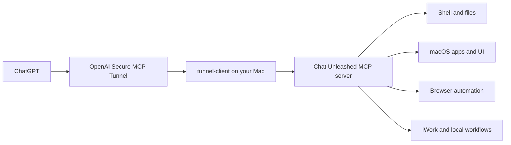

# Chat Unleashed

[](https://github.com/PotterSkxawng/chat-unleashed/actions/workflows/ci.yml)
[](LICENSE)
[](https://github.com/PotterSkxawng/chat-unleashed/releases/tag/preview-public-beta1)


**Give ChatGPT secure, local access to your Apple Silicon Mac.**

Chat Unleashed is an open-source MCP server that lets ChatGPT run commands, work with files, inspect the screen, control apps, automate a browser, edit iWork documents, and carry out longer local workflows. The server stays on your Mac. ChatGPT reaches it through an outbound OpenAI Secure MCP Tunnel.

> **Public Beta:** Chat Unleashed has full terminal and desktop access with the permissions of your macOS account. Read the [security model](#security-model) before connecting it.

## How it works



The MCP server and its settings API bind to loopback by default. You do not expose a public port or run a public reverse proxy.

## Quick start

### Requirements

- Apple Silicon Mac
- Node.js **20.11.1 or newer**
- Homebrew if `tunnel-client` is not already installed
- Access to OpenAI Secure MCP Tunnels for the ChatGPT workspace you want to connect

### Install

```sh
git clone https://github.com/PotterSkxawng/chat-unleashed.git
cd chat-unleashed
npm ci
npm run build
npm link
chat-unleashed setup
```

The setup wizard checks your Mac and Node version, installs `tunnel-client` when needed, asks for your tunnel ID and runtime key, writes protected local configuration, installs the background services, verifies a real MCP handshake, and enables the tunnel-preserving updater.

Then run:

```sh
chat-unleashed connect --open
```

That prints the five values to enter in ChatGPT and opens the relevant settings pages.

For the full walkthrough, see [Connecting ChatGPT](docs/CONNECT_CHATGPT.md).

## What you get

| Area | Capabilities |
| --- | --- |
| Terminal and files | Shell commands, long-lived shell sessions, file read/write/search, downloads, process control |
| Computer use | Screen capture, Accessibility inspection, keyboard, mouse, windows, menus, app control |
| Browser | Chromium DevTools automation, Safari fallback, DOM inspection, clicks, typing, downloads, console and network capture |
| iWork | Deep Pages, Numbers and Keynote creation, editing, formatting, inspection, export and verification |
| macOS apps | Calendar, Reminders, Notes, Contacts, Finder, Shortcuts, media, audio, system and network tools |
| Coding | Git operations, project context, code indexing, reviews, benchmarks and repository workflows |
| Durable work | Plans, saved task state, verification, resumable steps and reusable local skills |

Chat Unleashed currently exposes **114 MCP tools**. See the [full tool reference](docs/TOOLS.md) for the detailed catalog.

## The CLI

The `chat-unleashed` command is the human-facing control surface.

```text
CHAT UNLEASHED  [ Preview (Public Beta 1) ]  ChatGPT access to your Mac

● Ready · 114 tools available to ChatGPT

System         macOS · Apple Silicon · Node.js                         ✔
Secure Tunnel  Connected                                               ✔
MCP Server     114 tools online                                        ✔

Next: chat-unleashed connect
```

Common commands:

| Command | Purpose |
| --- | --- |
| `chat-unleashed` | Show current health and one recommended next action |
| `chat-unleashed setup` | Guided install and configuration |
| `chat-unleashed connect` | Print the ChatGPT connector values |
| `chat-unleashed doctor` | Diagnose the server, tunnel, permissions and configuration |
| `chat-unleashed update` | Fetch, build and stage a tunnel-safe update |
| `chat-unleashed status` | Compact health line, or JSON with `--json` |
| `chat-unleashed start` | Start the background services |
| `chat-unleashed stop` | Stop the background services |
| `chat-unleashed restart` | Explicitly restart both services |
| `chat-unleashed logs [server|tunnel|launchd]` | Follow a local log |

Useful options:

```text
--check      inspect setup/update without applying changes
--fresh      replace saved tunnel/key during setup
--stage      build and stage the current checkout
--status     show pending safe-update state
--cancel     cancel a pending safe update
--verbose    show diagnostic paths, URLs and timings
--json       machine-readable status output
--no-color   disable terminal styling
```

The shorter `local-mac` alias points to the same CLI.

## Security model

Chat Unleashed is deliberately powerful. It is not a sandbox.

- **Local listener:** the HTTP server binds to loopback by default and rejects unexpected Host and Origin values. The MCP transport also enables DNS-rebinding protection.
- **Remote path:** ChatGPT reaches the Mac through the configured outbound Secure MCP Tunnel. Do not expose the local HTTP port directly to a network.
- **macOS permissions:** Accessibility, Screen Recording, Automation and other permissions remain controlled by macOS. Grant only the permissions you need.
- **Audit history:** tool calls are written locally. Content-bearing fields such as typed text, document bodies and form values are redacted before logging, and successful tool-result text is not copied into the audit summary. Secret-looking fields, environment values, bearer tokens and common token formats are also redacted. The default audit history is bounded to four 8 MiB files.
- **Credentials:** the tunnel runtime key is stored in a `0600` local file and is not printed by the CLI.
- **Prompt injection:** files and web pages can contain untrusted instructions. Treat unexpected tool requests and sensitive actions carefully.
- **Full terminal access:** `run_command` can do anything your user account can do. There is intentionally no misleading "allowed roots" setting presented as a security boundary.

For vulnerability reporting and operational boundaries, read [SECURITY.md](SECURITY.md).

## Tunnel-safe updates

A normal update does **not** restart the tunnel.

```sh
chat-unleashed update
```

The CLI:

1. fetches `origin/main`,
2. fast-forwards the checkout,
3. installs the locked dependencies,
4. builds the candidate,
5. preflights it in an isolated local server,
6. stages it by SHA-256.

The background updater waits for 20 quiet minutes with no local or remote tool traffic. It then switches **only the local MCP server**, verifies the new process, and keeps the existing tunnel instance alive. If verification fails, it restores the previous bundle.

```sh
chat-unleashed update --status
chat-unleashed update --cancel
chat-unleashed update --stage
```

`chat-unleashed restart` is intentionally different: it explicitly restarts both services. Avoid it during an active ChatGPT session unless you want that interruption.

See [Deferred, tunnel-preserving updates](docs/DEFERRED_UPDATES.md) for the full design.

## Configuration and permissions

Saved configuration lives under:

```text
~/Library/Application Support/local-agent-mcp/
```

The tunnel profile and runtime credential are stored separately in their own protected user locations. The server re-reads its settings on each tool call, so most configuration changes do not require a restart.

Read [Configuration and permissions](docs/CONFIGURATION.md) for paths, the local settings API, macOS permissions and optional integrations.

## Documentation

- [Connect ChatGPT](docs/CONNECT_CHATGPT.md)
- [Tool reference](docs/TOOLS.md)
- [Configuration and permissions](docs/CONFIGURATION.md)
- [Troubleshooting](docs/TROUBLESHOOTING.md)
- [Tunnel-safe updates](docs/DEFERRED_UPDATES.md)
- [Security policy](SECURITY.md)
- [Contributing](CONTRIBUTING.md)
- [Support](SUPPORT.md)
- [Governance](GOVERNANCE.md)
- [Code of Conduct](CODE_OF_CONDUCT.md)

## Development

Install from the lockfile and run the release checks:

```sh
npm ci
npm run build
npm run smoke:logic
npm run smoke:portability
npm run check:public
npm run check:pack
```

The broader release suite also runs integration, stress and updater-safety checks:

```sh
npm run validate:release
```

CI runs on macOS and verifies the supported Node.js range. Some UI and Automation behavior still requires a real logged-in Mac with the corresponding macOS permissions.

The repository intentionally does not publish `local-agent-mcp` to npm yet. Install from this GitHub checkout or a GitHub release.

## License

Chat Unleashed is available under the [MIT License](LICENSE).
